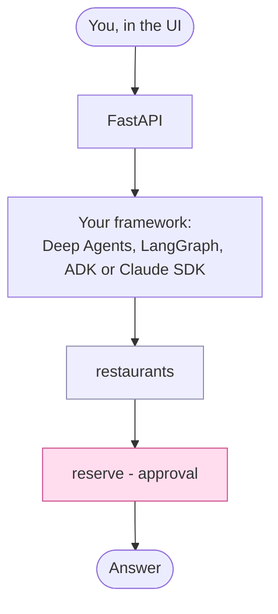

# 129. Restaurant that fits my diet

**Area:** Fitness, food and appointments  
**Features:** approval, uses preferences

Filters for your diet and books after approval.

## What you ask

> Dinner spot for 4 tonight, something everyone can eat.

## Flow



## Tools

| Tool | Effect | Control |
|---|---|---|
| `restaurants`: Restaurants. | read-only | - |
| `reserve`: Reserve a table. | talks to someone else | approval |

## Approvals

In the UI the run pauses and you decide. With auto-approve (demo), these decisions are used:

- `reserve`: approve

## Preferences it uses

| Preference | Default |
|---|---|
| `diet` | vegetarian |
| `home_city` | Chicago |

## Run it

```bash
python usecases/129_restaurant_for_diet/usecase.py                 # your preferred framework
python usecases/129_restaurant_for_diet/usecase.py --all           # all four frameworks
python usecases/129_restaurant_for_diet/usecase.py --manual        # answer the approvals yourself
python usecases/129_restaurant_for_diet/usecase.py --framework adk --live   # Gemini decides (needs GOOGLE_API_KEY)
```

Or start the app (`uvicorn app.api:app`), open http://localhost:8000 and pick it from the list.
