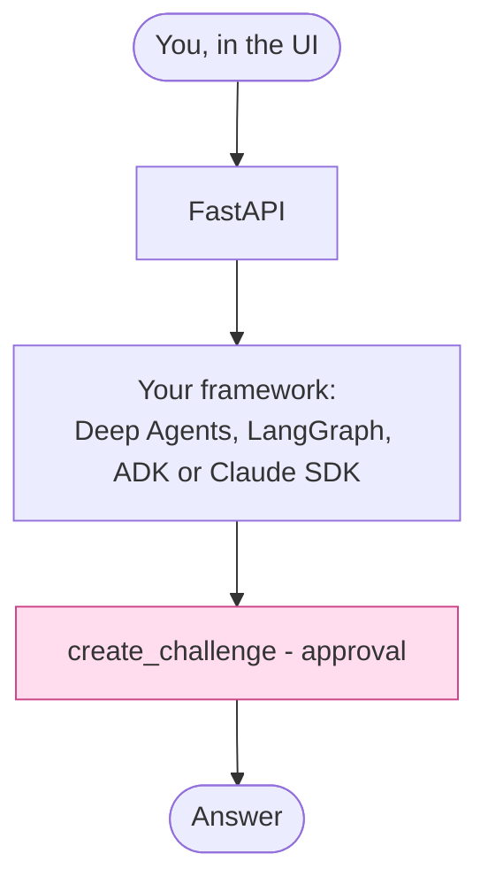

# 130. Step challenge with friends

**Area:** Fitness, food and appointments  
**Features:** approval

Creates the challenge and invites them after approval.

## What you ask

> Start a 7-day step challenge with Lee and Ana.

## Flow



## Tools

| Tool | Effect | Control |
|---|---|---|
| `create_challenge`: Create a step challenge. | talks to someone else | approval |

## Approvals

In the UI the run pauses and you decide. With auto-approve (demo), these decisions are used:

- `create_challenge`: approve

## Run it

```bash
python usecases/130_steps_challenge/usecase.py                 # your preferred framework
python usecases/130_steps_challenge/usecase.py --all           # all four frameworks
python usecases/130_steps_challenge/usecase.py --manual        # answer the approvals yourself
python usecases/130_steps_challenge/usecase.py --framework adk --live   # Gemini decides (needs GOOGLE_API_KEY)
```

Or start the app (`uvicorn app.api:app`), open http://localhost:8000 and pick it from the list.
