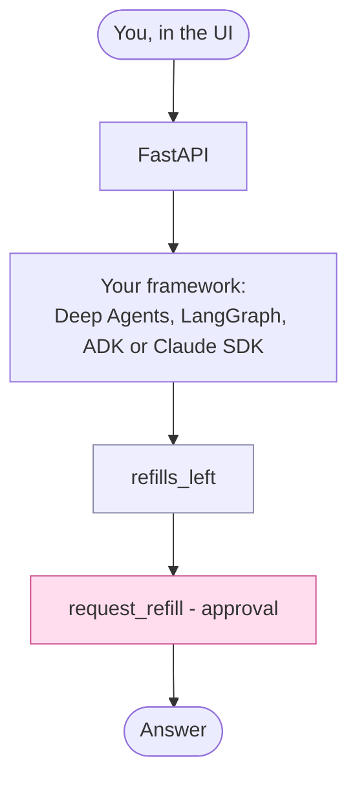

# 131. Refill a prescription

**Area:** Fitness, food and appointments  
**Features:** approval

Requests a refill from the pharmacy after approval. Logistics only.

## What you ask

> Refill my usual prescription.

## Flow



## Tools

| Tool | Effect | Control |
|---|---|---|
| `refills_left`: Refills remaining. | read-only | - |
| `request_refill`: Request a refill. | talks to someone else | approval |

## Approvals

In the UI the run pauses and you decide. With auto-approve (demo), these decisions are used:

- `request_refill`: approve

## Run it

```bash
python usecases/131_prescription_refill/usecase.py                 # your preferred framework
python usecases/131_prescription_refill/usecase.py --all           # all four frameworks
python usecases/131_prescription_refill/usecase.py --manual        # answer the approvals yourself
python usecases/131_prescription_refill/usecase.py --framework adk --live   # Gemini decides (needs GOOGLE_API_KEY)
```

Or start the app (`uvicorn app.api:app`), open http://localhost:8000 and pick it from the list.
