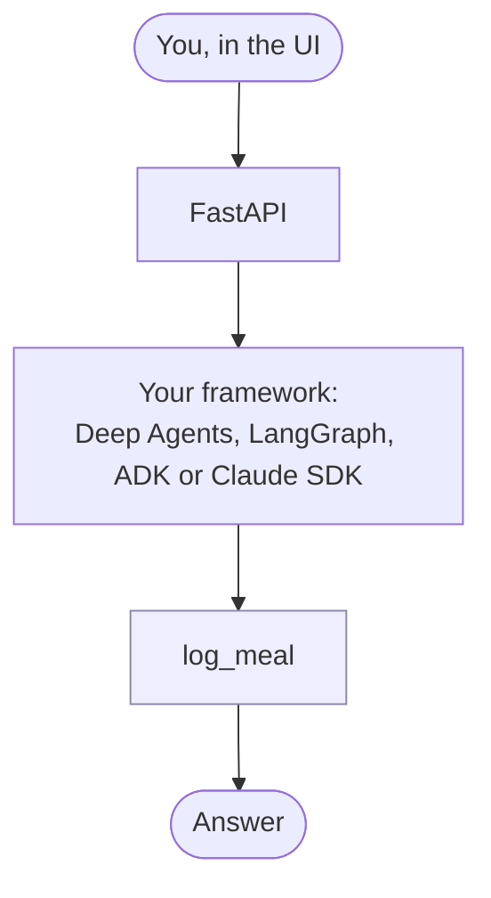

# 132. Log what I ate

**Area:** Fitness, food and appointments  
**Features:** tools only

Writes a simple food log. No targets, just a record.

## What you ask

> Log lunch: lentil soup and bread.

## Flow



## Tools

| Tool | Effect | Control |
|---|---|---|
| `log_meal`: Log a meal. | changes your data | - |

## Run it

```bash
python usecases/132_calorie_free_food_log/usecase.py                 # your preferred framework
python usecases/132_calorie_free_food_log/usecase.py --all           # all four frameworks
python usecases/132_calorie_free_food_log/usecase.py --manual        # answer the approvals yourself
python usecases/132_calorie_free_food_log/usecase.py --framework adk --live   # Gemini decides (needs GOOGLE_API_KEY)
```

Or start the app (`uvicorn app.api:app`), open http://localhost:8000 and pick it from the list.
