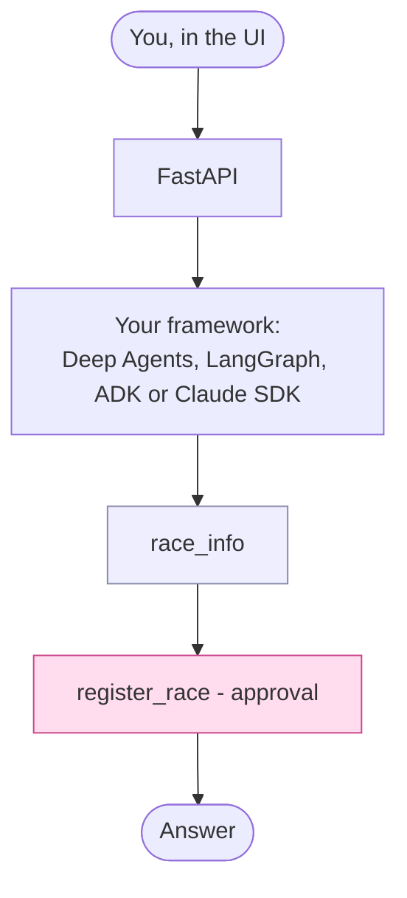

# 133. Sign up for a 10K

**Area:** Fitness, food and appointments  
**Features:** approval

Registration is a payment, so it needs approval.

## What you ask

> Sign me up for the spring 10K.

## Flow



## Tools

| Tool | Effect | Control |
|---|---|---|
| `race_info`: Race details. | read-only | - |
| `register_race`: Register for a race. | spends money | approval |

## Approvals

In the UI the run pauses and you decide. With auto-approve (demo), these decisions are used:

- `register_race`: approve

## Run it

```bash
python usecases/133_race_signup/usecase.py                 # your preferred framework
python usecases/133_race_signup/usecase.py --all           # all four frameworks
python usecases/133_race_signup/usecase.py --manual        # answer the approvals yourself
python usecases/133_race_signup/usecase.py --framework adk --live   # Gemini decides (needs GOOGLE_API_KEY)
```

Or start the app (`uvicorn app.api:app`), open http://localhost:8000 and pick it from the list.
