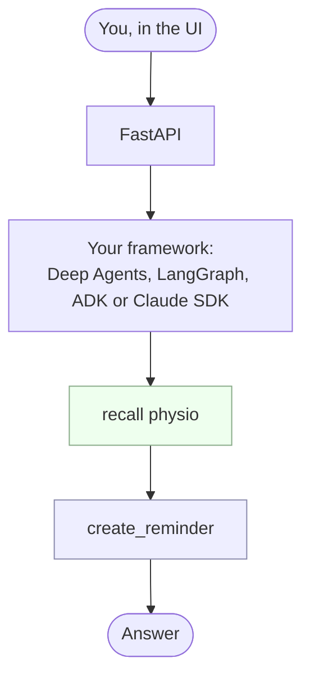

# 134. Physio exercise reminders

**Area:** Fitness, food and appointments  
**Features:** memory

Uses the routine your physio gave you (saved in memory).

## What you ask

> Remind me to do my physio exercises every evening.

## Flow



## Tools

| Tool | Effect | Control |
|---|---|---|
| `create_reminder`: Create a recurring reminder. | changes your data | - |

## Run it

```bash
python usecases/134_physio_exercises/usecase.py                 # your preferred framework
python usecases/134_physio_exercises/usecase.py --all           # all four frameworks
python usecases/134_physio_exercises/usecase.py --manual        # answer the approvals yourself
python usecases/134_physio_exercises/usecase.py --framework adk --live   # Gemini decides (needs GOOGLE_API_KEY)
```

Or start the app (`uvicorn app.api:app`), open http://localhost:8000 and pick it from the list.
