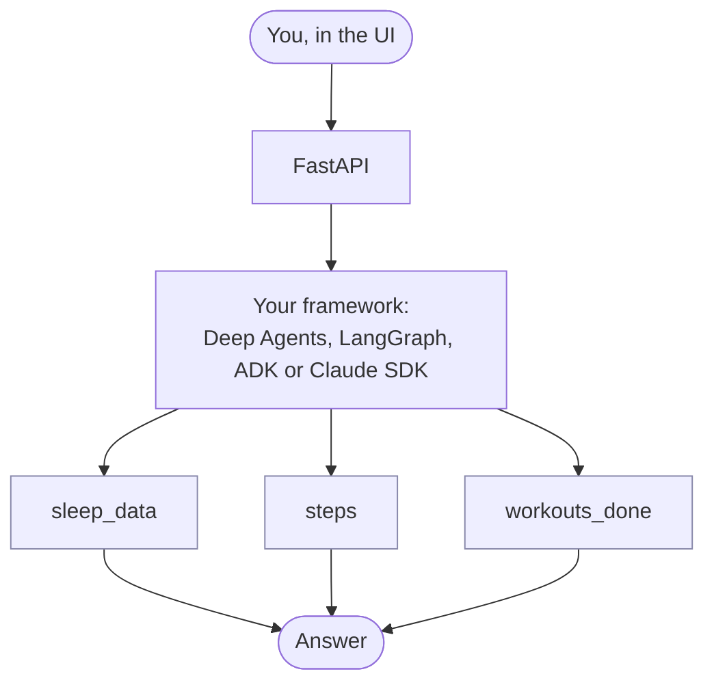

# 135. Weekly wellness summary

**Area:** Fitness, food and appointments  
**Features:** parallel calls

Three sources in parallel, one short summary.

## What you ask

> Give me my week: sleep, steps, workouts.

## Flow



## Tools

| Tool | Effect | Control |
|---|---|---|
| `sleep_data`: Sleep data. | read-only | - |
| `steps`: Daily steps. | read-only | - |
| `workouts_done`: Workouts completed. | read-only | - |

## Run it

```bash
python usecases/135_weekly_health_summary/usecase.py                 # your preferred framework
python usecases/135_weekly_health_summary/usecase.py --all           # all four frameworks
python usecases/135_weekly_health_summary/usecase.py --manual        # answer the approvals yourself
python usecases/135_weekly_health_summary/usecase.py --framework adk --live   # Gemini decides (needs GOOGLE_API_KEY)
```

Or start the app (`uvicorn app.api:app`), open http://localhost:8000 and pick it from the list.
