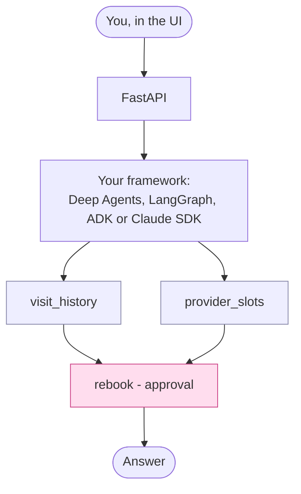

# 136. Book a dental cleaning

**Area:** Fitness, food and appointments  
**Features:** parallel calls, approval

Checks the history and books after approval.

## What you ask

> When was my last cleaning? Book the next one.

## Flow



## Tools

| Tool | Effect | Control |
|---|---|---|
| `visit_history`: Visit history. | read-only | - |
| `provider_slots`: Open slots. | read-only | - |
| `rebook`: Book an appointment. | talks to someone else | approval |

## Approvals

In the UI the run pauses and you decide. With auto-approve (demo), these decisions are used:

- `rebook`: approve

## Run it

```bash
python usecases/136_dentist_cleaning/usecase.py                 # your preferred framework
python usecases/136_dentist_cleaning/usecase.py --all           # all four frameworks
python usecases/136_dentist_cleaning/usecase.py --manual        # answer the approvals yourself
python usecases/136_dentist_cleaning/usecase.py --framework adk --live   # Gemini decides (needs GOOGLE_API_KEY)
```

Or start the app (`uvicorn app.api:app`), open http://localhost:8000 and pick it from the list.
