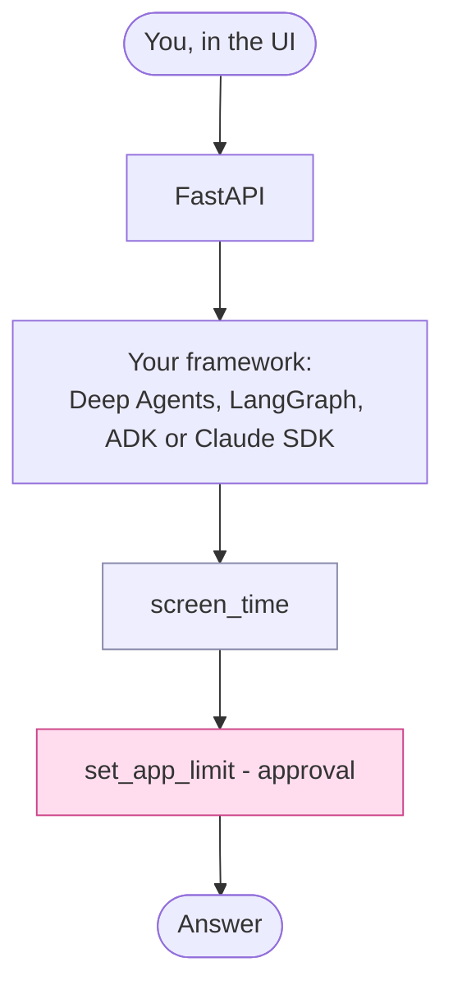

# 138. Screen time check

**Area:** Fitness, food and appointments  
**Features:** approval

Reads screen-time stats and sets one app limit after approval.

## What you ask

> How much time did I spend on my phone this week?

## Flow



## Tools

| Tool | Effect | Control |
|---|---|---|
| `screen_time`: Screen time by app. | read-only | - |
| `set_app_limit`: Set a daily app limit. | changes your data | approval |

## Approvals

In the UI the run pauses and you decide. With auto-approve (demo), these decisions are used:

- `set_app_limit`: approve

## Run it

```bash
python usecases/138_screen_time/usecase.py                 # your preferred framework
python usecases/138_screen_time/usecase.py --all           # all four frameworks
python usecases/138_screen_time/usecase.py --manual        # answer the approvals yourself
python usecases/138_screen_time/usecase.py --framework adk --live   # Gemini decides (needs GOOGLE_API_KEY)
```

Or start the app (`uvicorn app.api:app`), open http://localhost:8000 and pick it from the list.
