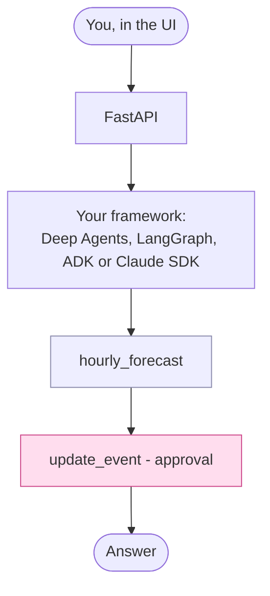

# 139. Turn a call into a walk

**Area:** Fitness, food and appointments  
**Features:** approval, uses preferences

Checks the weather and updates the event after approval.

## What you ask

> Make my 3pm call a walking meeting if the weather's OK.

## Flow



## Tools

| Tool | Effect | Control |
|---|---|---|
| `hourly_forecast`: Hourly forecast. | read-only | - |
| `update_event`: Update an event. | talks to someone else | approval |

## Approvals

In the UI the run pauses and you decide. With auto-approve (demo), these decisions are used:

- `update_event`: approve

## Preferences it uses

| Preference | Default |
|---|---|
| `home_city` | Chicago |

## Run it

```bash
python usecases/139_walking_meeting/usecase.py                 # your preferred framework
python usecases/139_walking_meeting/usecase.py --all           # all four frameworks
python usecases/139_walking_meeting/usecase.py --manual        # answer the approvals yourself
python usecases/139_walking_meeting/usecase.py --framework adk --live   # Gemini decides (needs GOOGLE_API_KEY)
```

Or start the app (`uvicorn app.api:app`), open http://localhost:8000 and pick it from the list.
