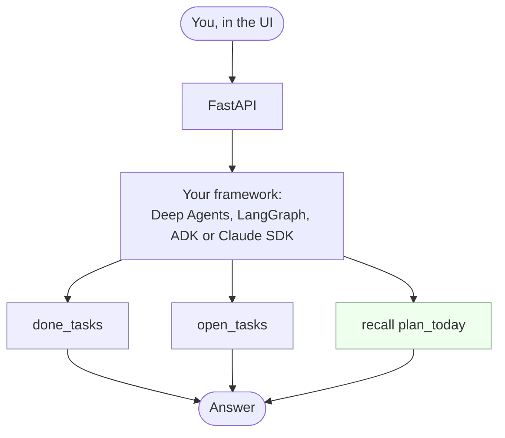

# 141. Draft my standup update

**Area:** Work and career  
**Features:** parallel calls, memory

Built from yesterday's finished tasks and today's plan.

## What you ask

> Draft my standup update.

## Flow



## Tools

| Tool | Effect | Control |
|---|---|---|
| `done_tasks`: Tasks done. | read-only | - |
| `open_tasks`: Open tasks. | read-only | - |

## Run it

```bash
python usecases/141_standup_update/usecase.py                 # your preferred framework
python usecases/141_standup_update/usecase.py --all           # all four frameworks
python usecases/141_standup_update/usecase.py --manual        # answer the approvals yourself
python usecases/141_standup_update/usecase.py --framework adk --live   # Gemini decides (needs GOOGLE_API_KEY)
```

Or start the app (`uvicorn app.api:app`), open http://localhost:8000 and pick it from the list.
