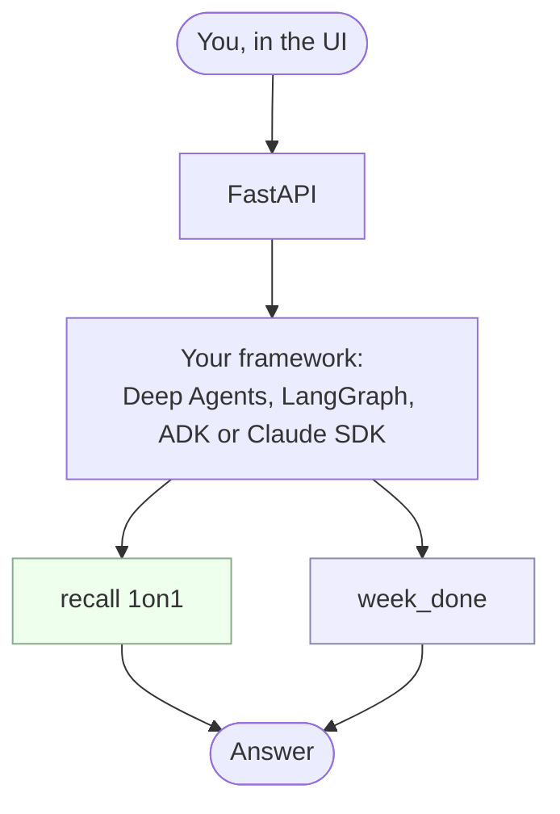

# 143. Prep for my 1:1

**Area:** Work and career  
**Features:** parallel calls, memory

Pulls topics you saved plus wins from the week.

## What you ask

> Prep my 1:1 with my manager.

## Flow



## Tools

| Tool | Effect | Control |
|---|---|---|
| `week_done`: Work finished this week. | read-only | - |

## Run it

```bash
python usecases/143_prep_one_on_one/usecase.py                 # your preferred framework
python usecases/143_prep_one_on_one/usecase.py --all           # all four frameworks
python usecases/143_prep_one_on_one/usecase.py --manual        # answer the approvals yourself
python usecases/143_prep_one_on_one/usecase.py --framework adk --live   # Gemini decides (needs GOOGLE_API_KEY)
```

Or start the app (`uvicorn app.api:app`), open http://localhost:8000 and pick it from the list.
