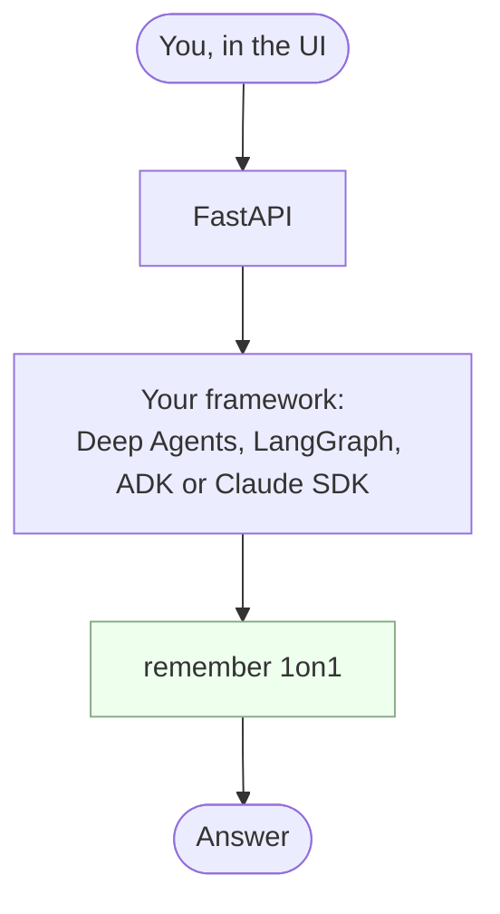

# 144. Save a 1:1 topic

**Area:** Work and career  
**Features:** memory

Saved to memory for the 1:1 prep task.

## What you ask

> For my next 1:1: ask about the training budget.

## Flow



## Tools

| Tool | Effect | Control |
|---|---|---|
| (only `remember` / `recall`) | memory | - |

## Run it

```bash
python usecases/144_save_1on1_topic/usecase.py                 # your preferred framework
python usecases/144_save_1on1_topic/usecase.py --all           # all four frameworks
python usecases/144_save_1on1_topic/usecase.py --manual        # answer the approvals yourself
python usecases/144_save_1on1_topic/usecase.py --framework adk --live   # Gemini decides (needs GOOGLE_API_KEY)
```

Or start the app (`uvicorn app.api:app`), open http://localhost:8000 and pick it from the list.
