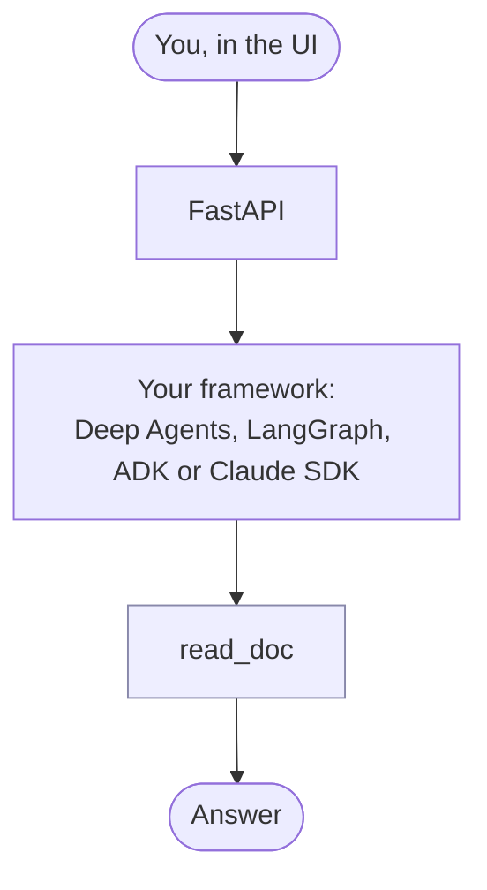

# 145. Summarize a long document

**Area:** Work and career  
**Features:** tools only

Reads the doc and pulls out terms, dates and anything unusual.

## What you ask

> Summarize the 40-page vendor contract.

## Flow



## Tools

| Tool | Effect | Control |
|---|---|---|
| `read_doc`: Read a document. | read-only | - |

## Run it

```bash
python usecases/145_document_summary/usecase.py                 # your preferred framework
python usecases/145_document_summary/usecase.py --all           # all four frameworks
python usecases/145_document_summary/usecase.py --manual        # answer the approvals yourself
python usecases/145_document_summary/usecase.py --framework adk --live   # Gemini decides (needs GOOGLE_API_KEY)
```

Or start the app (`uvicorn app.api:app`), open http://localhost:8000 and pick it from the list.
