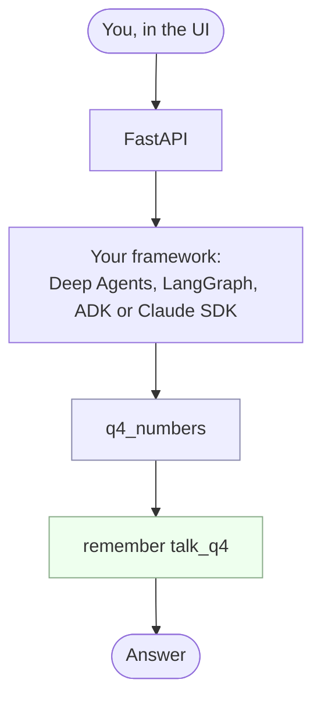

# 146. Outline a presentation

**Area:** Work and career  
**Features:** memory

Pulls the numbers and saves an outline.

## What you ask

> Outline a 10-minute talk on our Q4 results.

## Flow



## Tools

| Tool | Effect | Control |
|---|---|---|
| `q4_numbers`: Q4 figures. | read-only | - |

## Run it

```bash
python usecases/146_presentation_outline/usecase.py                 # your preferred framework
python usecases/146_presentation_outline/usecase.py --all           # all four frameworks
python usecases/146_presentation_outline/usecase.py --manual        # answer the approvals yourself
python usecases/146_presentation_outline/usecase.py --framework adk --live   # Gemini decides (needs GOOGLE_API_KEY)
```

Or start the app (`uvicorn app.api:app`), open http://localhost:8000 and pick it from the list.
