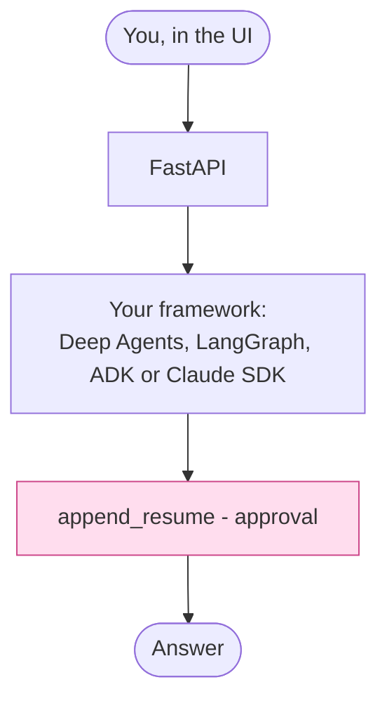

# 148. Add a win to my resume

**Area:** Work and career  
**Features:** approval

Edits your resume doc after you approve the wording.

## What you ask

> Add the quarterly report project to my resume.

## Flow



## Tools

| Tool | Effect | Control |
|---|---|---|
| `append_resume`: Append a bullet to the resume. | changes your data | approval |

## Approvals

In the UI the run pauses and you decide. With auto-approve (demo), these decisions are used:

- `append_resume`: approve with edits `bullet='Led the Q4 business review across 4 teams; cut prep time from 3 weeks to 1'`

## Run it

```bash
python usecases/148_update_resume/usecase.py                 # your preferred framework
python usecases/148_update_resume/usecase.py --all           # all four frameworks
python usecases/148_update_resume/usecase.py --manual        # answer the approvals yourself
python usecases/148_update_resume/usecase.py --framework adk --live   # Gemini decides (needs GOOGLE_API_KEY)
```

Or start the app (`uvicorn app.api:app`), open http://localhost:8000 and pick it from the list.
