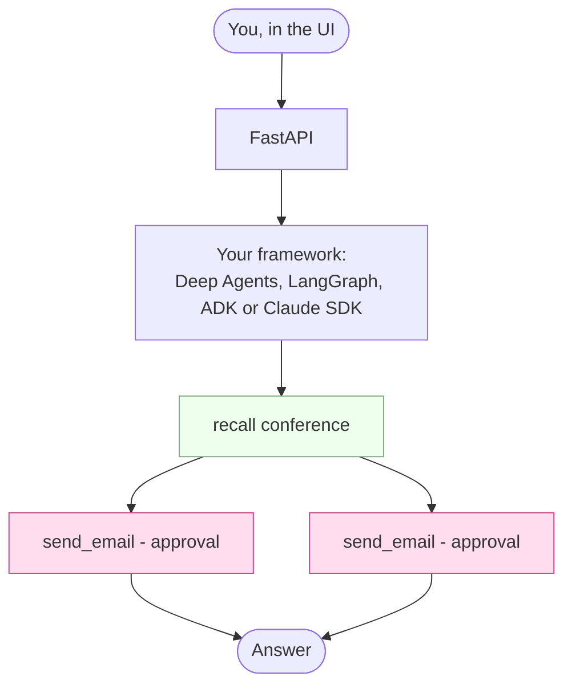

# 149. Follow up after a conference

**Area:** Work and career  
**Features:** parallel calls, approval, memory

Uses the contacts you saved and sends notes after approval.

## What you ask

> Follow up with the people I met at the conference.

## Flow



## Tools

| Tool | Effect | Control |
|---|---|---|
| `send_email`: Send an email. | talks to someone else | approval |

## Approvals

In the UI the run pauses and you decide. With auto-approve (demo), these decisions are used:

- `send_email`: approve

## Run it

```bash
python usecases/149_networking_follow_up/usecase.py                 # your preferred framework
python usecases/149_networking_follow_up/usecase.py --all           # all four frameworks
python usecases/149_networking_follow_up/usecase.py --manual        # answer the approvals yourself
python usecases/149_networking_follow_up/usecase.py --framework adk --live   # Gemini decides (needs GOOGLE_API_KEY)
```

Or start the app (`uvicorn app.api:app`), open http://localhost:8000 and pick it from the list.
