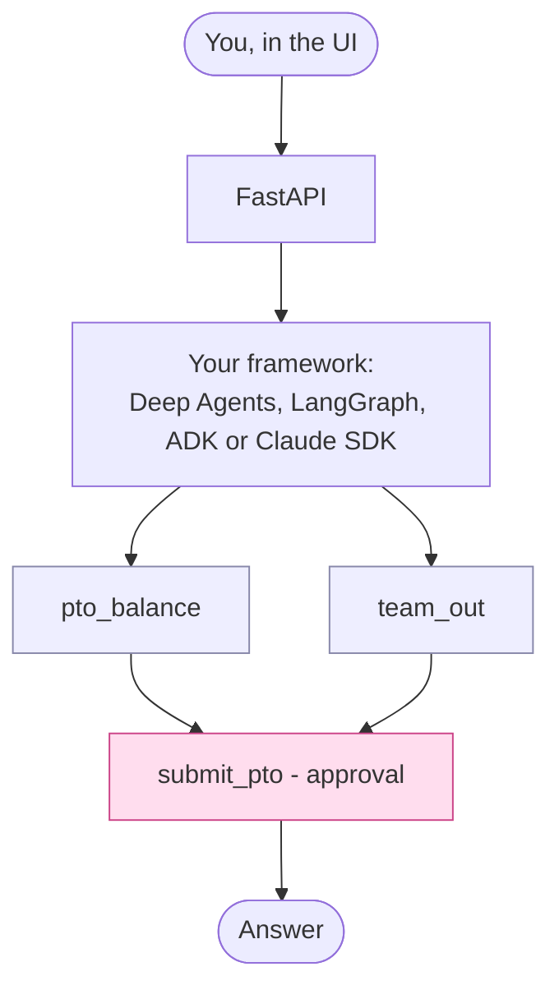

# 150. Request time off

**Area:** Work and career  
**Features:** parallel calls, approval

Checks the balance and team calendar, then submits after approval.

## What you ask

> Request PTO for April 3-13.

## Flow



## Tools

| Tool | Effect | Control |
|---|---|---|
| `pto_balance`: PTO balance. | read-only | - |
| `team_out`: Teammates out on dates. | read-only | - |
| `submit_pto`: Submit a PTO request. | talks to someone else | approval |

## Approvals

In the UI the run pauses and you decide. With auto-approve (demo), these decisions are used:

- `submit_pto`: approve

## Run it

```bash
python usecases/150_pto_request/usecase.py                 # your preferred framework
python usecases/150_pto_request/usecase.py --all           # all four frameworks
python usecases/150_pto_request/usecase.py --manual        # answer the approvals yourself
python usecases/150_pto_request/usecase.py --framework adk --live   # Gemini decides (needs GOOGLE_API_KEY)
```

Or start the app (`uvicorn app.api:app`), open http://localhost:8000 and pick it from the list.
