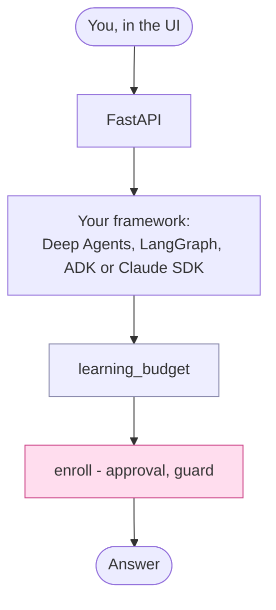

# 151. Use the learning budget

**Area:** Work and career  
**Features:** approval, guard

Checks the budget and enrolls. $349 is over your personal limit, but company-paid items have their own check.

## What you ask

> Enroll me in the data analysis course with my learning budget.

## Flow



## Tools

| Tool | Effect | Control |
|---|---|---|
| `learning_budget`: Remaining learning budget. | read-only | - |
| `enroll`: Enroll in a course (company-paid). | spends money | approval, guard |

## Approvals

In the UI the run pauses and you decide. With auto-approve (demo), these decisions are used:

- `enroll`: approve

## Guards

Checked in the shared tool layer before the tool runs, the same on every framework. Guards get your preferences, so changing a limit in the UI changes what's allowed.

- `enroll`

## Run it

```bash
python usecases/151_learning_budget_course/usecase.py                 # your preferred framework
python usecases/151_learning_budget_course/usecase.py --all           # all four frameworks
python usecases/151_learning_budget_course/usecase.py --manual        # answer the approvals yourself
python usecases/151_learning_budget_course/usecase.py --framework adk --live   # Gemini decides (needs GOOGLE_API_KEY)
```

Or start the app (`uvicorn app.api:app`), open http://localhost:8000 and pick it from the list.
