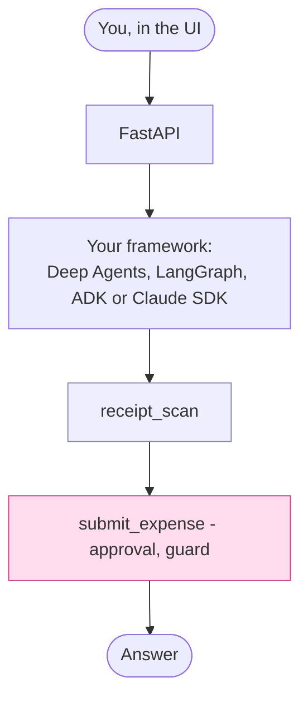

# 154. Submit a lunch receipt

**Area:** Work and career  
**Features:** approval, guard

Reads the receipt and submits after approval. Claims over $150 are blocked.

## What you ask

> Submit yesterday's client lunch receipt.

## Flow



## Tools

| Tool | Effect | Control |
|---|---|---|
| `receipt_scan`: Read a receipt photo. | read-only | - |
| `submit_expense`: Submit an expense. | talks to someone else | approval, guard |

## Approvals

In the UI the run pauses and you decide. With auto-approve (demo), these decisions are used:

- `submit_expense`: approve

## Guards

Checked in the shared tool layer before the tool runs, the same on every framework. Guards get your preferences, so changing a limit in the UI changes what's allowed.

- `submit_expense`

## Run it

```bash
python usecases/154_expense_receipt_snap/usecase.py                 # your preferred framework
python usecases/154_expense_receipt_snap/usecase.py --all           # all four frameworks
python usecases/154_expense_receipt_snap/usecase.py --manual        # answer the approvals yourself
python usecases/154_expense_receipt_snap/usecase.py --framework adk --live   # Gemini decides (needs GOOGLE_API_KEY)
```

Or start the app (`uvicorn app.api:app`), open http://localhost:8000 and pick it from the list.
