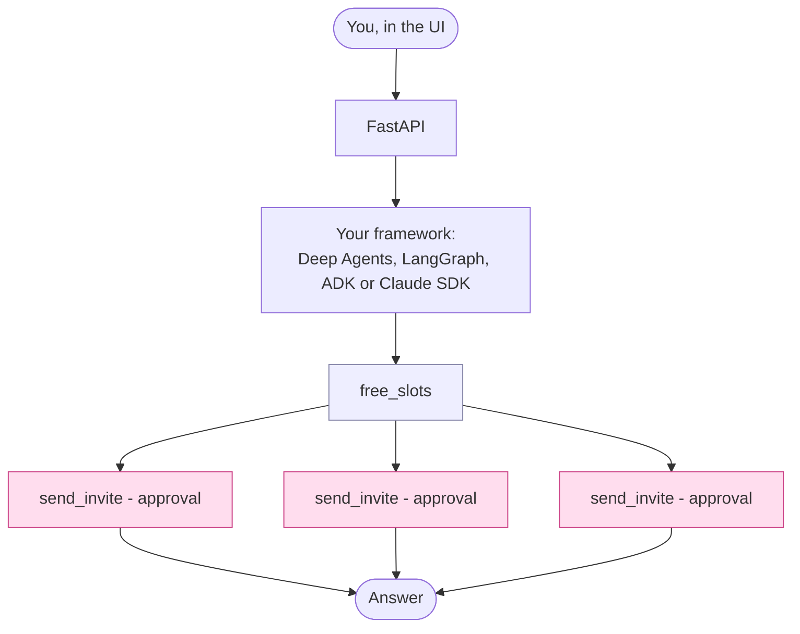

# 155. Schedule interviews

**Area:** Work and career  
**Features:** parallel calls, approval

Finds your free slots and sends invites after approval.

## What you ask

> Schedule 3 candidate interviews for next week.

## Flow



## Tools

| Tool | Effect | Control |
|---|---|---|
| `free_slots`: Free slots. | read-only | - |
| `send_invite`: Send an invite. | talks to someone else | approval |

## Approvals

In the UI the run pauses and you decide. With auto-approve (demo), these decisions are used:

- `send_invite`: approve

## Run it

```bash
python usecases/155_interview_scheduling/usecase.py                 # your preferred framework
python usecases/155_interview_scheduling/usecase.py --all           # all four frameworks
python usecases/155_interview_scheduling/usecase.py --manual        # answer the approvals yourself
python usecases/155_interview_scheduling/usecase.py --framework adk --live   # Gemini decides (needs GOOGLE_API_KEY)
```

Or start the app (`uvicorn app.api:app`), open http://localhost:8000 and pick it from the list.
