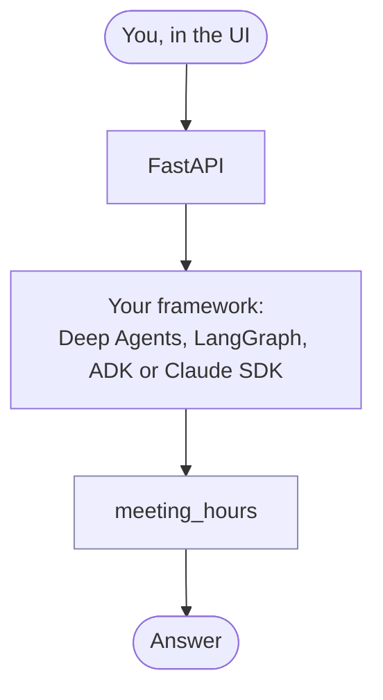

# 158. Which meetings cost the most time

**Area:** Work and career  
**Features:** tools only

Sums meeting hours by series.

## What you ask

> Which meetings take most of my week?

## Flow



## Tools

| Tool | Effect | Control |
|---|---|---|
| `meeting_hours`: Hours per meeting series. | read-only | - |

## Run it

```bash
python usecases/158_meeting_cost/usecase.py                 # your preferred framework
python usecases/158_meeting_cost/usecase.py --all           # all four frameworks
python usecases/158_meeting_cost/usecase.py --manual        # answer the approvals yourself
python usecases/158_meeting_cost/usecase.py --framework adk --live   # Gemini decides (needs GOOGLE_API_KEY)
```

Or start the app (`uvicorn app.api:app`), open http://localhost:8000 and pick it from the list.
