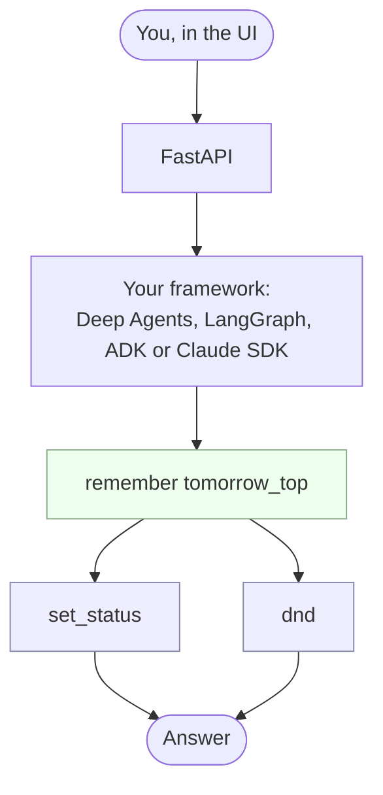

# 159. End-of-day shutdown

**Area:** Work and career  
**Features:** parallel calls, memory

Saves tomorrow's top task, sets your status and turns off work notifications.

## What you ask

> Shut down my workday.

## Flow



## Tools

| Tool | Effect | Control |
|---|---|---|
| `set_status`: Set chat status. | changes your data | - |
| `dnd`: Do not disturb. | changes your data | - |

## Run it

```bash
python usecases/159_end_of_day_shutdown/usecase.py                 # your preferred framework
python usecases/159_end_of_day_shutdown/usecase.py --all           # all four frameworks
python usecases/159_end_of_day_shutdown/usecase.py --manual        # answer the approvals yourself
python usecases/159_end_of_day_shutdown/usecase.py --framework adk --live   # Gemini decides (needs GOOGLE_API_KEY)
```

Or start the app (`uvicorn app.api:app`), open http://localhost:8000 and pick it from the list.
