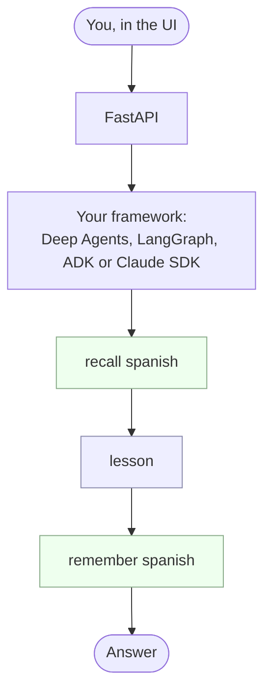

# 161. Daily Spanish practice

**Area:** Learning and hobbies  
**Features:** memory

Picks up where you left off (saved in memory) and saves progress.

## What you ask

> Give me today's Spanish practice.

## Flow



## Tools

| Tool | Effect | Control |
|---|---|---|
| `lesson`: Next lesson for a level. | read-only | - |

## Run it

```bash
python usecases/161_daily_language_practice/usecase.py                 # your preferred framework
python usecases/161_daily_language_practice/usecase.py --all           # all four frameworks
python usecases/161_daily_language_practice/usecase.py --manual        # answer the approvals yourself
python usecases/161_daily_language_practice/usecase.py --framework adk --live   # Gemini decides (needs GOOGLE_API_KEY)
```

Or start the app (`uvicorn app.api:app`), open http://localhost:8000 and pick it from the list.
