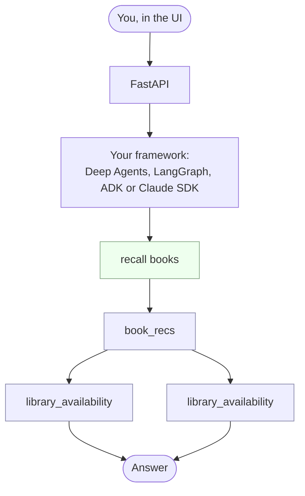

# 162. What should I read next

**Area:** Learning and hobbies  
**Features:** parallel calls, memory

Uses books you liked (saved in memory) and checks library availability.

## What you ask

> What should I read next?

## Flow



## Tools

| Tool | Effect | Control |
|---|---|---|
| `book_recs`: Recommendations from liked books. | read-only | - |
| `library_availability`: Library availability. | read-only | - |

## Run it

```bash
python usecases/162_reading_list/usecase.py                 # your preferred framework
python usecases/162_reading_list/usecase.py --all           # all four frameworks
python usecases/162_reading_list/usecase.py --manual        # answer the approvals yourself
python usecases/162_reading_list/usecase.py --framework adk --live   # Gemini decides (needs GOOGLE_API_KEY)
```

Or start the app (`uvicorn app.api:app`), open http://localhost:8000 and pick it from the list.
