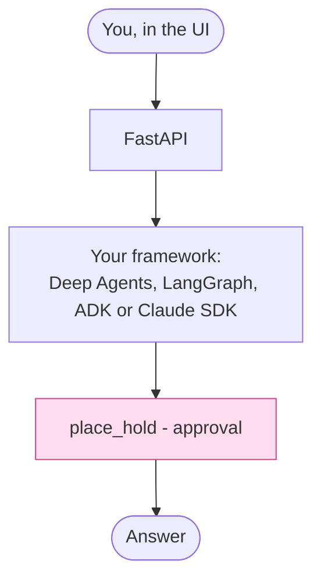

# 163. Place a library hold

**Area:** Learning and hobbies  
**Features:** approval

A small action, but it's on your account, so it needs approval.

## What you ask

> Put Klara and the Sun on hold.

## Flow



## Tools

| Tool | Effect | Control |
|---|---|---|
| `place_hold`: Place a library hold. | talks to someone else | approval |

## Approvals

In the UI the run pauses and you decide. With auto-approve (demo), these decisions are used:

- `place_hold`: approve

## Run it

```bash
python usecases/163_place_library_hold/usecase.py                 # your preferred framework
python usecases/163_place_library_hold/usecase.py --all           # all four frameworks
python usecases/163_place_library_hold/usecase.py --manual        # answer the approvals yourself
python usecases/163_place_library_hold/usecase.py --framework adk --live   # Gemini decides (needs GOOGLE_API_KEY)
```

Or start the app (`uvicorn app.api:app`), open http://localhost:8000 and pick it from the list.
