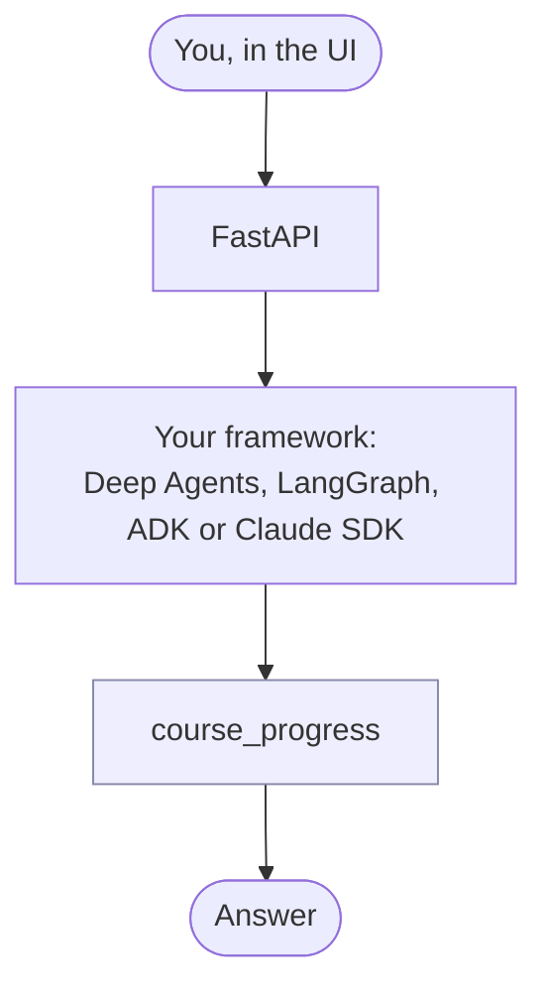

# 164. Online course progress

**Area:** Learning and hobbies  
**Features:** tools only

Reads progress and suggests a pace to finish on time.

## What you ask

> How far am I in the data analysis course?

## Flow



## Tools

| Tool | Effect | Control |
|---|---|---|
| `course_progress`: Course progress. | read-only | - |

## Run it

```bash
python usecases/164_course_progress/usecase.py                 # your preferred framework
python usecases/164_course_progress/usecase.py --all           # all four frameworks
python usecases/164_course_progress/usecase.py --manual        # answer the approvals yourself
python usecases/164_course_progress/usecase.py --framework adk --live   # Gemini decides (needs GOOGLE_API_KEY)
```

Or start the app (`uvicorn app.api:app`), open http://localhost:8000 and pick it from the list.
