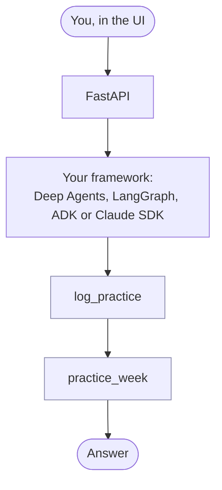

# 166. Guitar practice log

**Area:** Learning and hobbies  
**Features:** tools only

Keeps a practice log and shows the weekly total.

## What you ask

> Log 30 minutes of guitar: worked on barre chords.

## Flow



## Tools

| Tool | Effect | Control |
|---|---|---|
| `log_practice`: Log practice. | changes your data | - |
| `practice_week`: Practice minutes this week. | read-only | - |

## Run it

```bash
python usecases/166_guitar_practice_log/usecase.py                 # your preferred framework
python usecases/166_guitar_practice_log/usecase.py --all           # all four frameworks
python usecases/166_guitar_practice_log/usecase.py --manual        # answer the approvals yourself
python usecases/166_guitar_practice_log/usecase.py --framework adk --live   # Gemini decides (needs GOOGLE_API_KEY)
```

Or start the app (`uvicorn app.api:app`), open http://localhost:8000 and pick it from the list.
