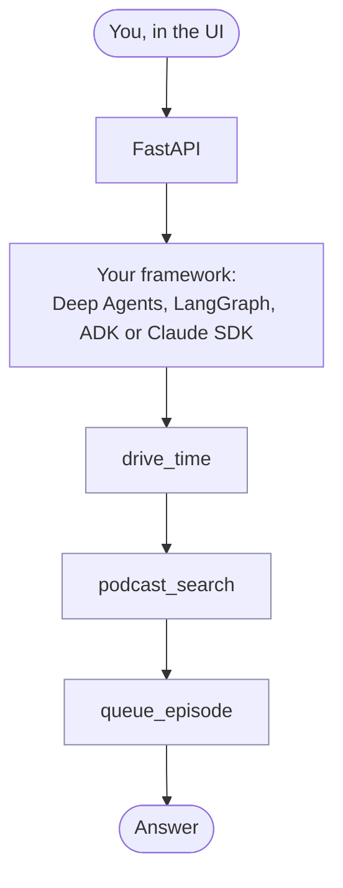

# 167. Podcasts for my commute

**Area:** Learning and hobbies  
**Features:** uses preferences

Picks episodes that fit your commute time and topics.

## What you ask

> Queue podcasts for tomorrow's commute.

## Flow



## Tools

| Tool | Effect | Control |
|---|---|---|
| `drive_time`: Commute time. | read-only | - |
| `podcast_search`: Episodes by topic and length. | read-only | - |
| `queue_episode`: Add to queue. | changes your data | - |

## Preferences it uses

| Preference | Default |
|---|---|
| `home_city` | Chicago |
| `news_topics` | AI, climate, Chicago |

## Run it

```bash
python usecases/167_podcast_queue/usecase.py                 # your preferred framework
python usecases/167_podcast_queue/usecase.py --all           # all four frameworks
python usecases/167_podcast_queue/usecase.py --manual        # answer the approvals yourself
python usecases/167_podcast_queue/usecase.py --framework adk --live   # Gemini decides (needs GOOGLE_API_KEY)
```

Or start the app (`uvicorn app.api:app`), open http://localhost:8000 and pick it from the list.
