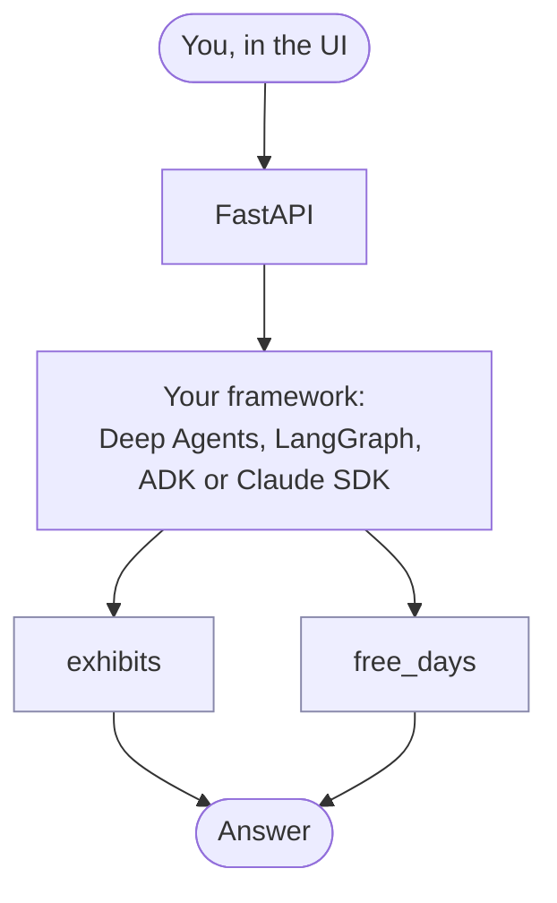

# 168. Museum visit this weekend

**Area:** Learning and hobbies  
**Features:** parallel calls, uses preferences

Checks exhibits and free-admission days together.

## What you ask

> Any good exhibits this weekend, and free days?

## Flow



## Tools

| Tool | Effect | Control |
|---|---|---|
| `exhibits`: Current exhibits. | read-only | - |
| `free_days`: Free admission days. | read-only | - |

## Preferences it uses

| Preference | Default |
|---|---|
| `home_city` | Chicago |

## Run it

```bash
python usecases/168_museum_visit/usecase.py                 # your preferred framework
python usecases/168_museum_visit/usecase.py --all           # all four frameworks
python usecases/168_museum_visit/usecase.py --manual        # answer the approvals yourself
python usecases/168_museum_visit/usecase.py --framework adk --live   # Gemini decides (needs GOOGLE_API_KEY)
```

Or start the app (`uvicorn app.api:app`), open http://localhost:8000 and pick it from the list.
