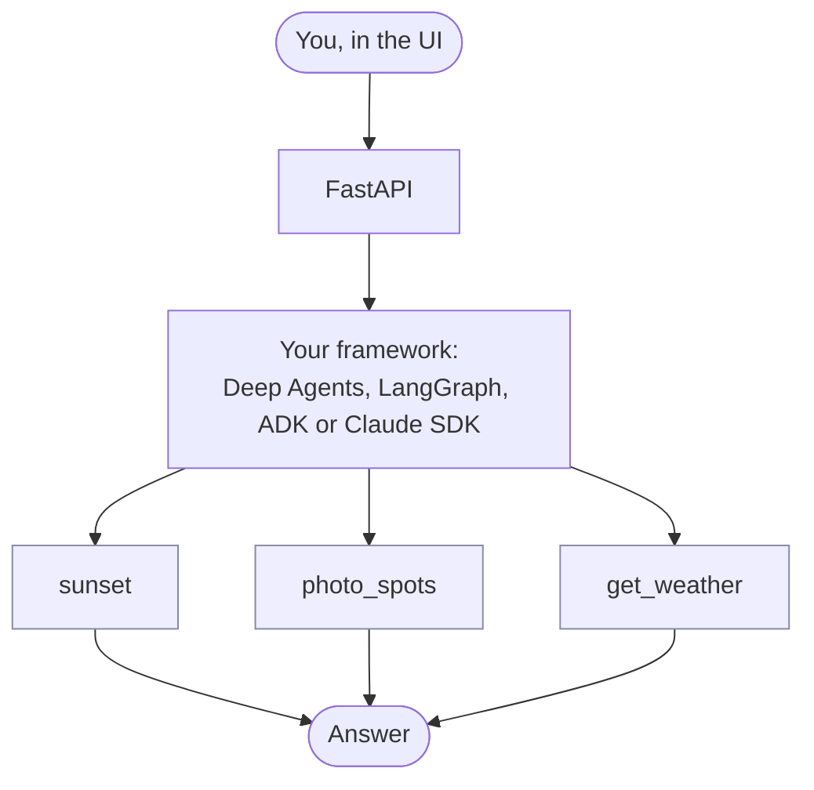

# 170. Photo spots at sunset

**Area:** Learning and hobbies  
**Features:** parallel calls, uses preferences

Sunset times and spots, with the weather check.

## What you ask

> Where should I take sunset photos this week?

## Flow



## Tools

| Tool | Effect | Control |
|---|---|---|
| `sunset`: Sunset time. | read-only | - |
| `photo_spots`: Photo spots. | read-only | - |
| `get_weather`: Weather. | read-only | - |

## Preferences it uses

| Preference | Default |
|---|---|
| `home_city` | Chicago |

## Run it

```bash
python usecases/170_photography_tips/usecase.py                 # your preferred framework
python usecases/170_photography_tips/usecase.py --all           # all four frameworks
python usecases/170_photography_tips/usecase.py --manual        # answer the approvals yourself
python usecases/170_photography_tips/usecase.py --framework adk --live   # Gemini decides (needs GOOGLE_API_KEY)
```

Or start the app (`uvicorn app.api:app`), open http://localhost:8000 and pick it from the list.
