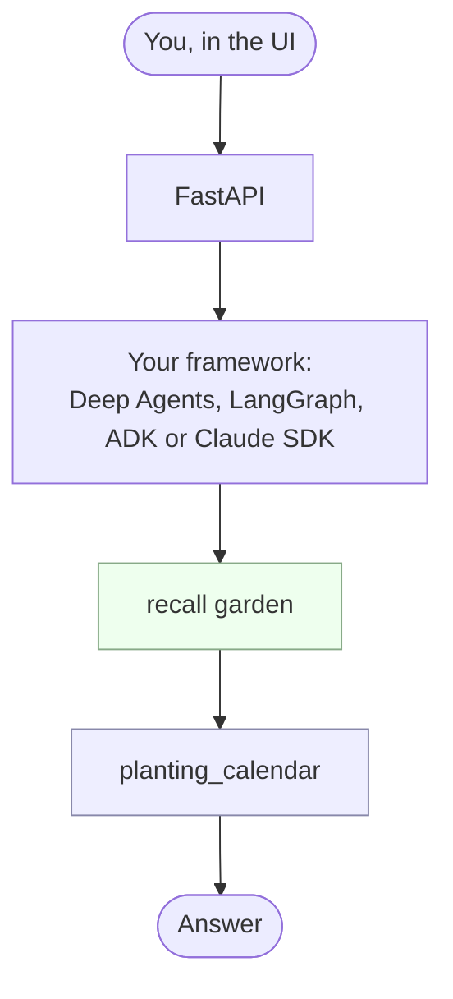

# 171. Plan the spring garden

**Area:** Learning and hobbies  
**Features:** memory

Uses your growing zone and what grew well last year (saved in memory).

## What you ask

> What should I plant this spring?

## Flow



## Tools

| Tool | Effect | Control |
|---|---|---|
| `planting_calendar`: Planting calendar for a zone. | read-only | - |

## Run it

```bash
python usecases/171_garden_plan/usecase.py                 # your preferred framework
python usecases/171_garden_plan/usecase.py --all           # all four frameworks
python usecases/171_garden_plan/usecase.py --manual        # answer the approvals yourself
python usecases/171_garden_plan/usecase.py --framework adk --live   # Gemini decides (needs GOOGLE_API_KEY)
```

Or start the app (`uvicorn app.api:app`), open http://localhost:8000 and pick it from the list.
