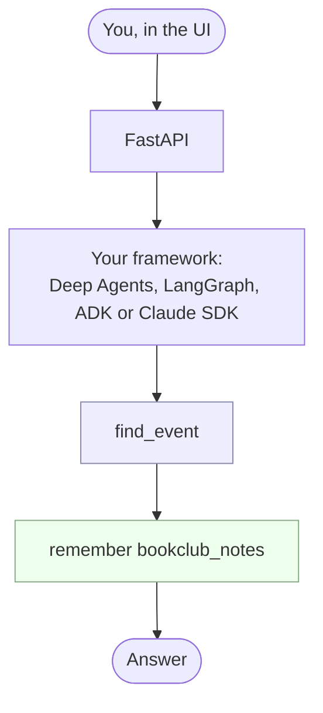

# 172. Book club prep

**Area:** Learning and hobbies  
**Features:** memory

Pulls the meeting date and saves your discussion notes.

## What you ask

> Prep me for book club: questions on Sea of Tranquility.

## Flow



## Tools

| Tool | Effect | Control |
|---|---|---|
| `find_event`: Find an event. | read-only | - |

## Run it

```bash
python usecases/172_book_club_summary/usecase.py                 # your preferred framework
python usecases/172_book_club_summary/usecase.py --all           # all four frameworks
python usecases/172_book_club_summary/usecase.py --manual        # answer the approvals yourself
python usecases/172_book_club_summary/usecase.py --framework adk --live   # Gemini decides (needs GOOGLE_API_KEY)
```

Or start the app (`uvicorn app.api:app`), open http://localhost:8000 and pick it from the list.
