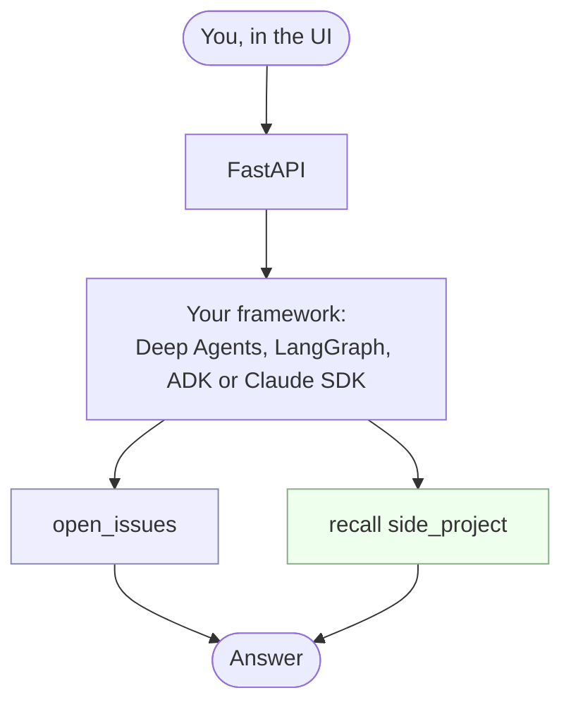

# 173. Side project: what's next

**Area:** Learning and hobbies  
**Features:** parallel calls, memory

Reads the issue list and your notes, then picks one task.

## What you ask

> What's next on my side project?

## Flow



## Tools

| Tool | Effect | Control |
|---|---|---|
| `open_issues`: Open issues in a repo. | read-only | - |

## Run it

```bash
python usecases/173_coding_side_project/usecase.py                 # your preferred framework
python usecases/173_coding_side_project/usecase.py --all           # all four frameworks
python usecases/173_coding_side_project/usecase.py --manual        # answer the approvals yourself
python usecases/173_coding_side_project/usecase.py --framework adk --live   # Gemini decides (needs GOOGLE_API_KEY)
```

Or start the app (`uvicorn app.api:app`), open http://localhost:8000 and pick it from the list.
