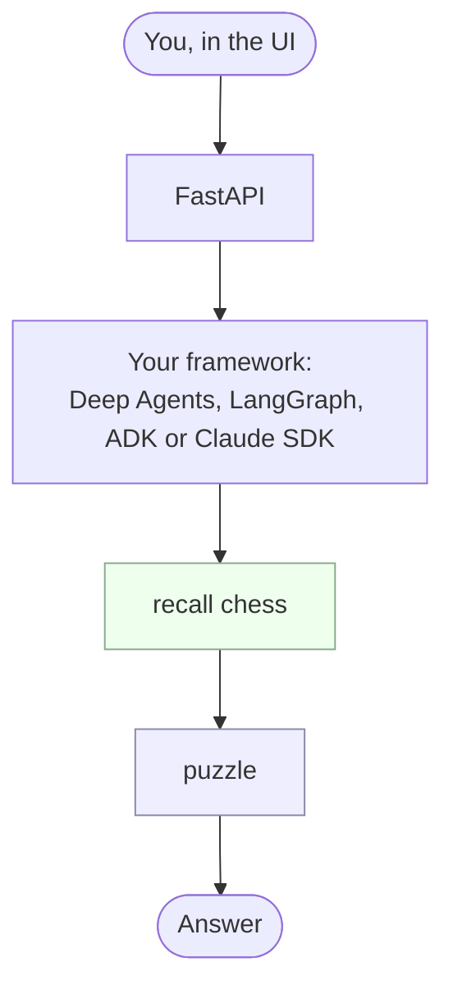

# 175. Daily chess puzzle

**Area:** Learning and hobbies  
**Features:** memory

Uses your rating from memory.

## What you ask

> Give me today's chess puzzle at my level.

## Flow



## Tools

| Tool | Effect | Control |
|---|---|---|
| `puzzle`: A puzzle at a rating. | read-only | - |

## Run it

```bash
python usecases/175_chess_puzzle_daily/usecase.py                 # your preferred framework
python usecases/175_chess_puzzle_daily/usecase.py --all           # all four frameworks
python usecases/175_chess_puzzle_daily/usecase.py --manual        # answer the approvals yourself
python usecases/175_chess_puzzle_daily/usecase.py --framework adk --live   # Gemini decides (needs GOOGLE_API_KEY)
```

Or start the app (`uvicorn app.api:app`), open http://localhost:8000 and pick it from the list.
