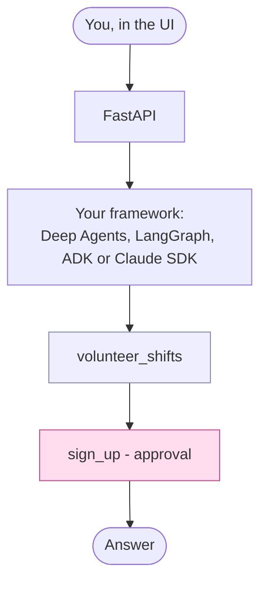

# 176. Sign up to volunteer

**Area:** Learning and hobbies  
**Features:** approval, uses preferences

Signing up commits your time, so it needs approval.

## What you ask

> Find a volunteer shift this month and sign me up.

## Flow



## Tools

| Tool | Effect | Control |
|---|---|---|
| `volunteer_shifts`: Open volunteer shifts. | read-only | - |
| `sign_up`: Sign up for a shift. | talks to someone else | approval |

## Approvals

In the UI the run pauses and you decide. With auto-approve (demo), these decisions are used:

- `sign_up`: approve

## Preferences it uses

| Preference | Default |
|---|---|
| `home_city` | Chicago |

## Run it

```bash
python usecases/176_volunteer_shift/usecase.py                 # your preferred framework
python usecases/176_volunteer_shift/usecase.py --all           # all four frameworks
python usecases/176_volunteer_shift/usecase.py --manual        # answer the approvals yourself
python usecases/176_volunteer_shift/usecase.py --framework adk --live   # Gemini decides (needs GOOGLE_API_KEY)
```

Or start the app (`uvicorn app.api:app`), open http://localhost:8000 and pick it from the list.
