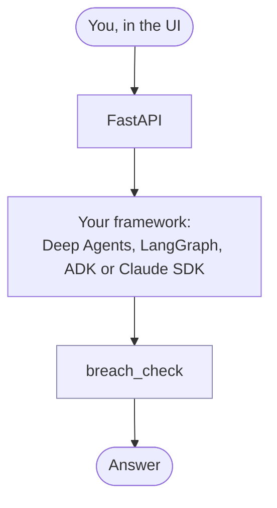

# 181. Were any of my accounts breached?

**Area:** Documents, accounts and digital life  
**Features:** tools only

Checks breach data and lists which accounts to change. It never sees passwords.

## What you ask

> Check if my email showed up in a data breach.

## Flow



## Tools

| Tool | Effect | Control |
|---|---|---|
| `breach_check`: Breaches for an email address. | read-only | - |

## Run it

```bash
python usecases/181_password_breach_check/usecase.py                 # your preferred framework
python usecases/181_password_breach_check/usecase.py --all           # all four frameworks
python usecases/181_password_breach_check/usecase.py --manual        # answer the approvals yourself
python usecases/181_password_breach_check/usecase.py --framework adk --live   # Gemini decides (needs GOOGLE_API_KEY)
```

Or start the app (`uvicorn app.api:app`), open http://localhost:8000 and pick it from the list.
