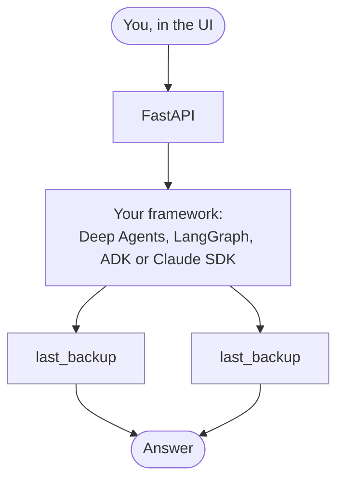

# 182. Are my backups working

**Area:** Documents, accounts and digital life  
**Features:** parallel calls

Checks both backup services.

## What you ask

> Did my laptop and phone back up this week?

## Flow



## Tools

| Tool | Effect | Control |
|---|---|---|
| `last_backup`: Last backup of a device. | read-only | - |

## Run it

```bash
python usecases/182_backup_check/usecase.py                 # your preferred framework
python usecases/182_backup_check/usecase.py --all           # all four frameworks
python usecases/182_backup_check/usecase.py --manual        # answer the approvals yourself
python usecases/182_backup_check/usecase.py --framework adk --live   # Gemini decides (needs GOOGLE_API_KEY)
```

Or start the app (`uvicorn app.api:app`), open http://localhost:8000 and pick it from the list.
