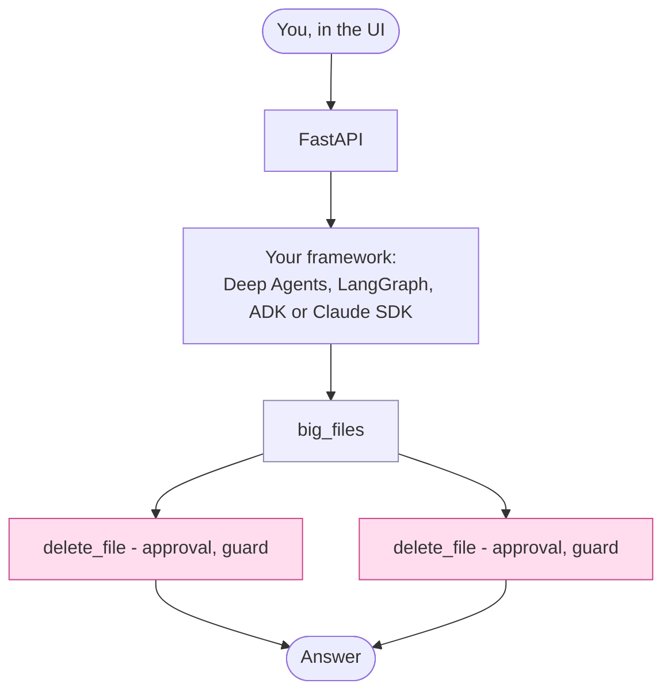

# 183. Free up cloud storage

**Area:** Documents, accounts and digital life  
**Features:** parallel calls, approval, guard

Finds big duplicate files. Deleting needs approval, and the Photos folder is protected.

## What you ask

> My cloud storage is full. Clean it up.

## Flow



## Tools

| Tool | Effect | Control |
|---|---|---|
| `big_files`: Largest files. | read-only | - |
| `delete_file`: Delete a file. | changes your data | approval, guard |

## Approvals

In the UI the run pauses and you decide. With auto-approve (demo), these decisions are used:

- `delete_file`: approve

## Guards

Checked in the shared tool layer before the tool runs, the same on every framework. Guards get your preferences, so changing a limit in the UI changes what's allowed.

- `delete_file`

## Run it

```bash
python usecases/183_free_up_storage/usecase.py                 # your preferred framework
python usecases/183_free_up_storage/usecase.py --all           # all four frameworks
python usecases/183_free_up_storage/usecase.py --manual        # answer the approvals yourself
python usecases/183_free_up_storage/usecase.py --framework adk --live   # Gemini decides (needs GOOGLE_API_KEY)
```

Or start the app (`uvicorn app.api:app`), open http://localhost:8000 and pick it from the list.
