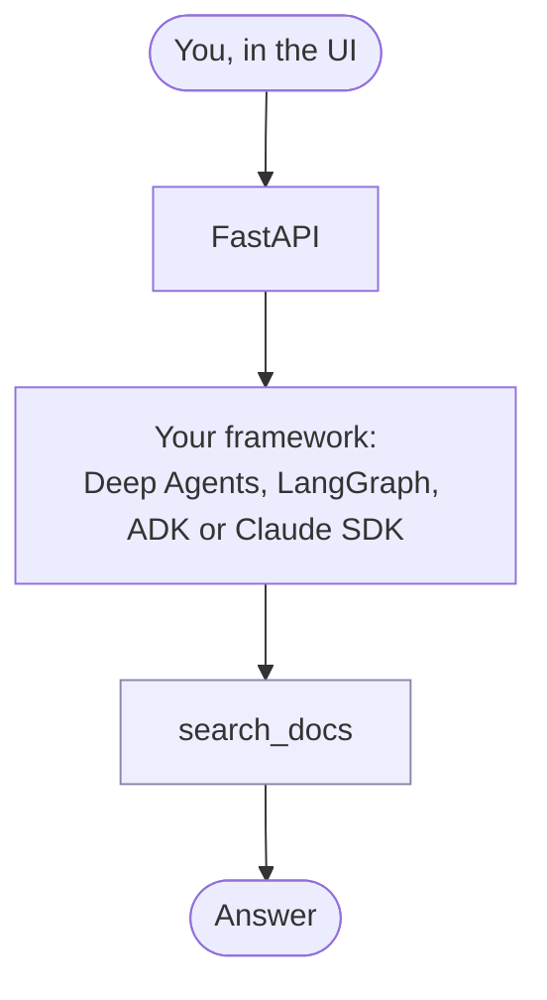

# 184. Find a document

**Area:** Documents, accounts and digital life  
**Features:** tools only

Searches the documents drive.

## What you ask

> Find my car title document.

## Flow



## Tools

| Tool | Effect | Control |
|---|---|---|
| `search_docs`: Search your documents. | read-only | - |

## Run it

```bash
python usecases/184_document_finder/usecase.py                 # your preferred framework
python usecases/184_document_finder/usecase.py --all           # all four frameworks
python usecases/184_document_finder/usecase.py --manual        # answer the approvals yourself
python usecases/184_document_finder/usecase.py --framework adk --live   # Gemini decides (needs GOOGLE_API_KEY)
```

Or start the app (`uvicorn app.api:app`), open http://localhost:8000 and pick it from the list.
