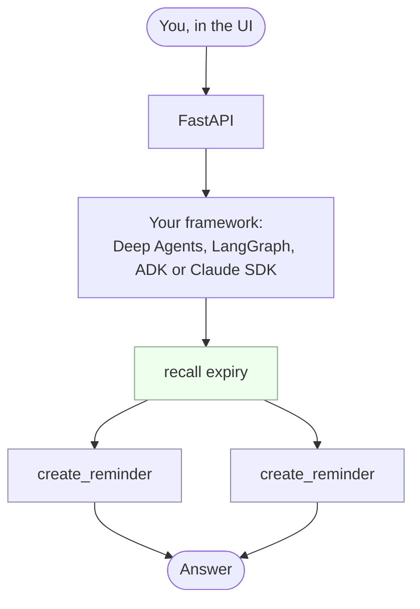

# 185. Document renewal dates

**Area:** Documents, accounts and digital life  
**Features:** parallel calls, memory

Reads the expiry dates you saved and sets reminders.

## What you ask

> When do my license and passport need renewing?

## Flow



## Tools

| Tool | Effect | Control |
|---|---|---|
| `create_reminder`: Create a reminder. | changes your data | - |

## Run it

```bash
python usecases/185_id_renewal_reminders/usecase.py                 # your preferred framework
python usecases/185_id_renewal_reminders/usecase.py --all           # all four frameworks
python usecases/185_id_renewal_reminders/usecase.py --manual        # answer the approvals yourself
python usecases/185_id_renewal_reminders/usecase.py --framework adk --live   # Gemini decides (needs GOOGLE_API_KEY)
```

Or start the app (`uvicorn app.api:app`), open http://localhost:8000 and pick it from the list.
