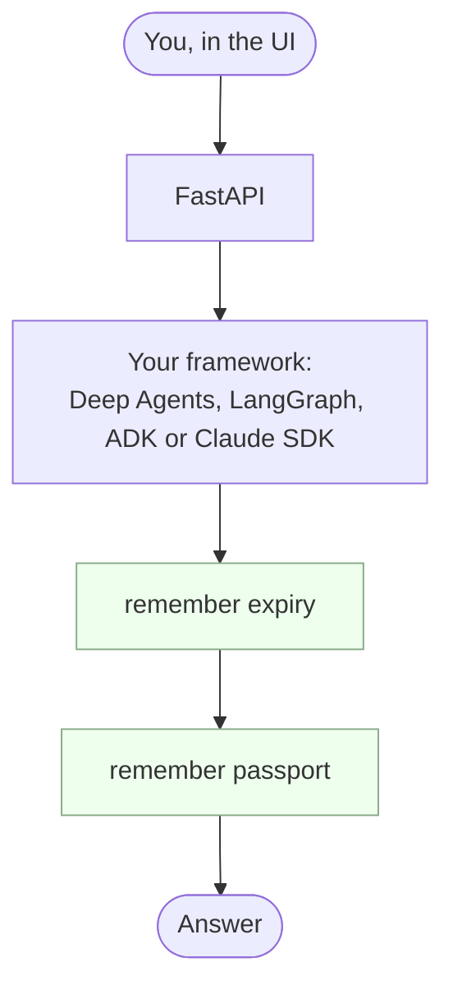

# 186. Save expiry dates

**Area:** Documents, accounts and digital life  
**Features:** memory

Only the dates are saved, never the ID numbers.

## What you ask

> My license expires March 2027, passport June 2027.

## Flow



## Tools

| Tool | Effect | Control |
|---|---|---|
| (only `remember` / `recall`) | memory | - |

## Run it

```bash
python usecases/186_save_expiry_dates/usecase.py                 # your preferred framework
python usecases/186_save_expiry_dates/usecase.py --all           # all four frameworks
python usecases/186_save_expiry_dates/usecase.py --manual        # answer the approvals yourself
python usecases/186_save_expiry_dates/usecase.py --framework adk --live   # Gemini decides (needs GOOGLE_API_KEY)
```

Or start the app (`uvicorn app.api:app`), open http://localhost:8000 and pick it from the list.
