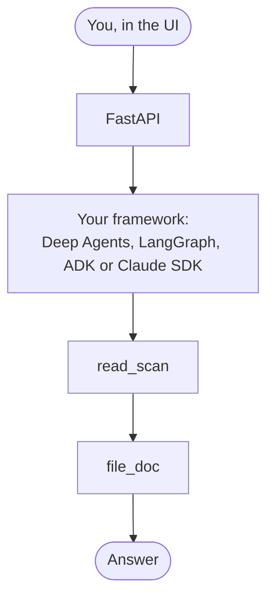

# 187. Scan and file a letter

**Area:** Documents, accounts and digital life  
**Features:** tools only

Reads the scan, names it properly and files it.

## What you ask

> File the insurance letter I just scanned.

## Flow



## Tools

| Tool | Effect | Control |
|---|---|---|
| `read_scan`: Read a scanned document. | read-only | - |
| `file_doc`: Save a document to a folder. | changes your data | - |

## Run it

```bash
python usecases/187_scan_and_file/usecase.py                 # your preferred framework
python usecases/187_scan_and_file/usecase.py --all           # all four frameworks
python usecases/187_scan_and_file/usecase.py --manual        # answer the approvals yourself
python usecases/187_scan_and_file/usecase.py --framework adk --live   # Gemini decides (needs GOOGLE_API_KEY)
```

Or start the app (`uvicorn app.api:app`), open http://localhost:8000 and pick it from the list.
