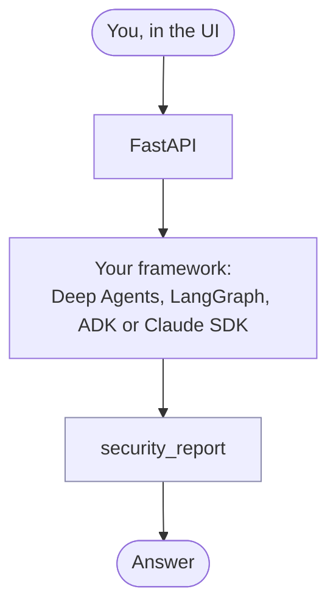

# 188. Which accounts lack 2FA

**Area:** Documents, accounts and digital life  
**Features:** tools only

Checks the password manager's security report.

## What you ask

> Which of my important accounts don't have 2FA?

## Flow



## Tools

| Tool | Effect | Control |
|---|---|---|
| `security_report`: Password manager security report. | read-only | - |

## Run it

```bash
python usecases/188_two_factor_audit/usecase.py                 # your preferred framework
python usecases/188_two_factor_audit/usecase.py --all           # all four frameworks
python usecases/188_two_factor_audit/usecase.py --manual        # answer the approvals yourself
python usecases/188_two_factor_audit/usecase.py --framework adk --live   # Gemini decides (needs GOOGLE_API_KEY)
```

Or start the app (`uvicorn app.api:app`), open http://localhost:8000 and pick it from the list.
