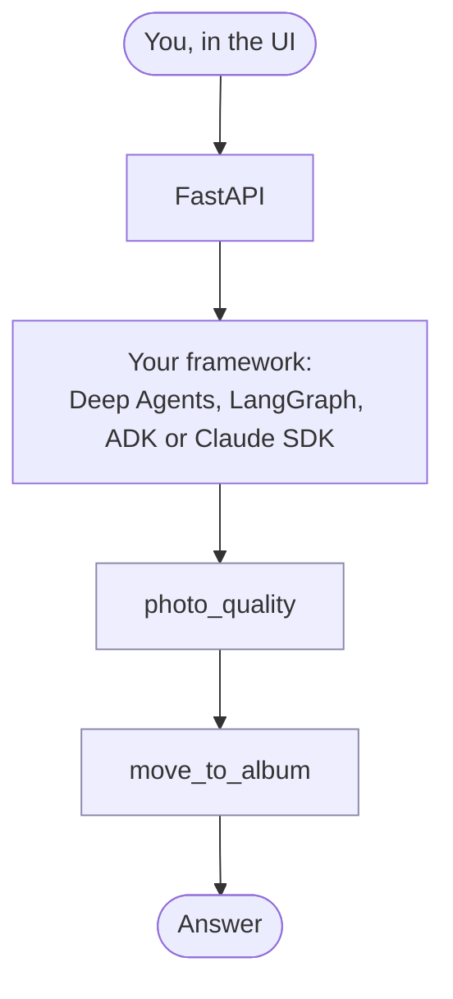

# 189. Clean up blurry photos

**Area:** Documents, accounts and digital life  
**Features:** tools only

Moves them to a review album. It doesn't delete.

## What you ask

> Find blurry and duplicate photos from this month.

## Flow



## Tools

| Tool | Effect | Control |
|---|---|---|
| `photo_quality`: Find blurry and duplicate photos. | read-only | - |
| `move_to_album`: Move photos to an album. | changes your data | - |

## Run it

```bash
python usecases/189_photo_cleanup/usecase.py                 # your preferred framework
python usecases/189_photo_cleanup/usecase.py --all           # all four frameworks
python usecases/189_photo_cleanup/usecase.py --manual        # answer the approvals yourself
python usecases/189_photo_cleanup/usecase.py --framework adk --live   # Gemini decides (needs GOOGLE_API_KEY)
```

Or start the app (`uvicorn app.api:app`), open http://localhost:8000 and pick it from the list.
