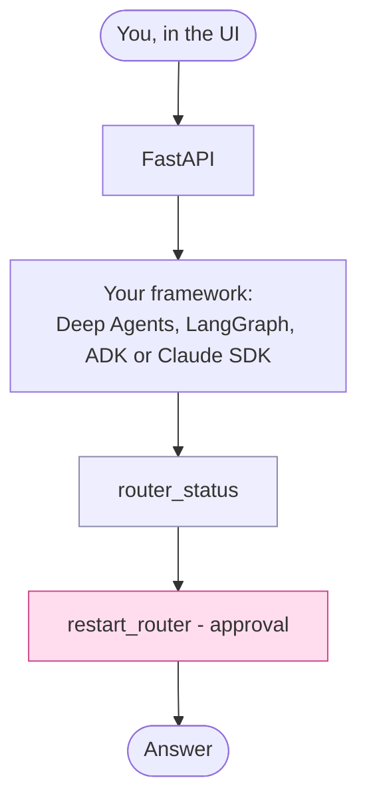

# 190. Why is the Wi-Fi slow

**Area:** Documents, accounts and digital life  
**Features:** approval

Checks the router and the connected devices, then restarts after approval.

## What you ask

> The Wi-Fi is slow. What's wrong?

## Flow



## Tools

| Tool | Effect | Control |
|---|---|---|
| `router_status`: Router status. | read-only | - |
| `restart_router`: Restart the router. | changes your data | approval |

## Approvals

In the UI the run pauses and you decide. With auto-approve (demo), these decisions are used:

- `restart_router`: approve

## Run it

```bash
python usecases/190_wifi_troubleshoot/usecase.py                 # your preferred framework
python usecases/190_wifi_troubleshoot/usecase.py --all           # all four frameworks
python usecases/190_wifi_troubleshoot/usecase.py --manual        # answer the approvals yourself
python usecases/190_wifi_troubleshoot/usecase.py --framework adk --live   # Gemini decides (needs GOOGLE_API_KEY)
```

Or start the app (`uvicorn app.api:app`), open http://localhost:8000 and pick it from the list.
