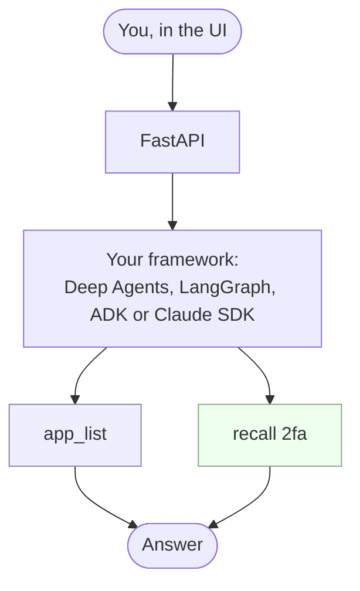

# 191. New phone checklist

**Area:** Documents, accounts and digital life  
**Features:** parallel calls, memory

Builds a checklist from the apps and 2FA you saved in memory.

## What you ask

> I got a new phone. What do I need to move over?

## Flow



## Tools

| Tool | Effect | Control |
|---|---|---|
| `app_list`: Apps on the old phone. | read-only | - |

## Run it

```bash
python usecases/191_new_phone_setup/usecase.py                 # your preferred framework
python usecases/191_new_phone_setup/usecase.py --all           # all four frameworks
python usecases/191_new_phone_setup/usecase.py --manual        # answer the approvals yourself
python usecases/191_new_phone_setup/usecase.py --framework adk --live   # Gemini decides (needs GOOGLE_API_KEY)
```

Or start the app (`uvicorn app.api:app`), open http://localhost:8000 and pick it from the list.
