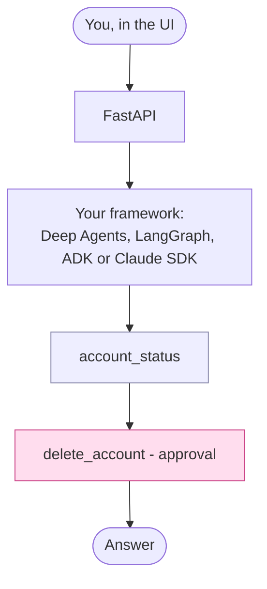

# 192. Close an old account

**Area:** Documents, accounts and digital life  
**Features:** approval

Deleting an account can't be undone, so it needs approval.

## What you ask

> Delete my OldForum account.

## Flow



## Tools

| Tool | Effect | Control |
|---|---|---|
| `account_status`: Account status. | read-only | - |
| `delete_account`: Request account deletion. | talks to someone else | approval |

## Approvals

In the UI the run pauses and you decide. With auto-approve (demo), these decisions are used:

- `delete_account`: approve

## Run it

```bash
python usecases/192_cancel_unused_account/usecase.py                 # your preferred framework
python usecases/192_cancel_unused_account/usecase.py --all           # all four frameworks
python usecases/192_cancel_unused_account/usecase.py --manual        # answer the approvals yourself
python usecases/192_cancel_unused_account/usecase.py --framework adk --live   # Gemini decides (needs GOOGLE_API_KEY)
```

Or start the app (`uvicorn app.api:app`), open http://localhost:8000 and pick it from the list.
