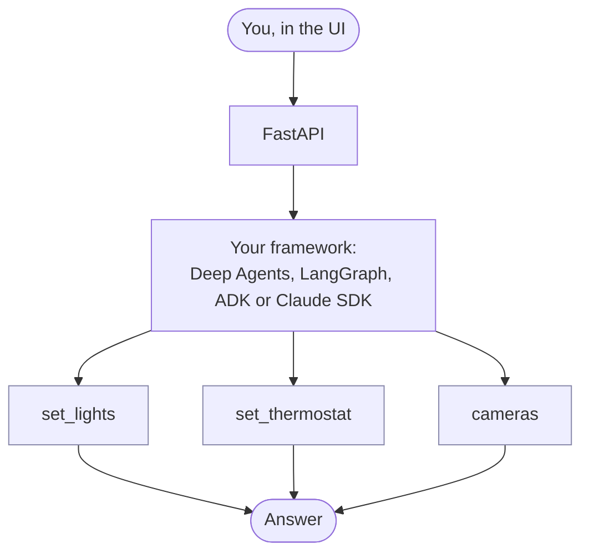

# 194. Leaving-home routine

**Area:** Documents, accounts and digital life  
**Features:** parallel calls

Lights off, thermostat down, and the cameras on.

## What you ask

> Run my leaving-home routine.

## Flow



## Tools

| Tool | Effect | Control |
|---|---|---|
| `set_lights`: Set lights. | changes your data | - |
| `set_thermostat`: Set the thermostat. | changes your data | - |
| `cameras`: Turn cameras on or off. | changes your data | - |

## Run it

```bash
python usecases/194_smart_home_routine/usecase.py                 # your preferred framework
python usecases/194_smart_home_routine/usecase.py --all           # all four frameworks
python usecases/194_smart_home_routine/usecase.py --manual        # answer the approvals yourself
python usecases/194_smart_home_routine/usecase.py --framework adk --live   # Gemini decides (needs GOOGLE_API_KEY)
```

Or start the app (`uvicorn app.api:app`), open http://localhost:8000 and pick it from the list.
