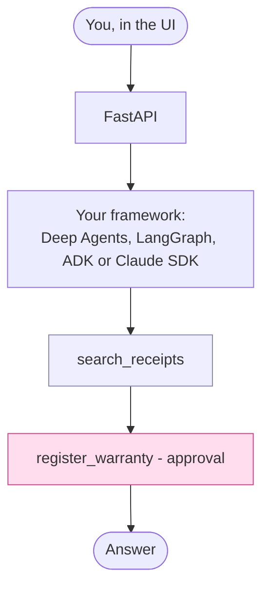

# 195. Register a new purchase's warranty

**Area:** Documents, accounts and digital life  
**Features:** approval

Pulls the serial number from the receipt and registers it.

## What you ask

> Register the warranty for the new TV.

## Flow



## Tools

| Tool | Effect | Control |
|---|---|---|
| `search_receipts`: Search receipts. | read-only | - |
| `register_warranty`: Register a warranty. | talks to someone else | approval |

## Approvals

In the UI the run pauses and you decide. With auto-approve (demo), these decisions are used:

- `register_warranty`: approve

## Run it

```bash
python usecases/195_warranty_registry/usecase.py                 # your preferred framework
python usecases/195_warranty_registry/usecase.py --all           # all four frameworks
python usecases/195_warranty_registry/usecase.py --manual        # answer the approvals yourself
python usecases/195_warranty_registry/usecase.py --framework adk --live   # Gemini decides (needs GOOGLE_API_KEY)
```

Or start the app (`uvicorn app.api:app`), open http://localhost:8000 and pick it from the list.
